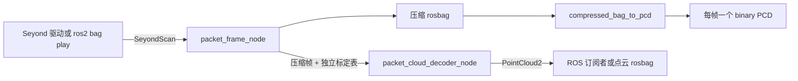

# 激光雷达 SuperPacketMode 详解

面向 ROS 2 集成工程师及其 AI 工具。本文定义当前交付版本的输入、输出、二进制布局、标定时序和验收方式。适用设备为 Seyond Robin W，目标环境为 Jetson AGX Thor、Ubuntu 24.04、ROS 2 Jazzy、arm64。

## 1. 工程边界与目录

| 根目录 | 职责 | 主要入口 |
|---|---|---|
| `compress_ros/` | ROS 消息定义、组包压缩节点、共享 RBP3 编解码器和原包回放入口 | `robinw_packet_frame/src/packet_frame_node.cpp`、`robinw_packet_frame/msg/`、`robinw_packet_frame/launch/` |
| `decode_ros/` | 在线解压节点、在线和离线共用的点云解码器、Seyond SDK 与转换器 | `src/packet_cloud_decoder_node.cpp`、`src/point_cloud_decoder.cpp`、`vendor/` |
| `pcd_export/` | 从压缩 rosbag 导出逐帧 binary PCD | `src/compressed_bag_to_pcd.cpp`、`src/pcd_writer.hpp` |
| `tests/` | 实包回归、校准表时序、点云与 PCD 对比 | `verify_end_to_end.py` |

ROS 包名仍为 `robinw_packet_frame`，三套可执行程序仍由同一个 ROS 包构建。CMake 入口在 `compress_ros/robinw_packet_frame/CMakeLists.txt`，它引用另外两个目录中的源文件。当前安装只支持 RBP3 单帧预测格式。`compress_ros/seyond` 是上游 `SeyondScan`、`SeyondPacket` 的兼容消息包。Seyond 源码取自 `seyond_sw_ros` 提交 `c736b03ccd3c821f5ea8d1392dc9d8263594b521`，许可证位于 `decode_ros/vendor/seyond_inno_sdk/LICENSE`。转换器有本地的标定表更新接口，供离线和在线解码共用。



每路雷达独立运行一套节点、话题和标定状态。前中、后中示例命名空间分别为 `/front_mid`、`/rear_mid`。两路标定表分别来自各自雷达。

## 2. ROS 接口

以下相对话题名由各实例的命名空间解析，原始输入由 `input_topic` 指定。

| 话题 | 消息类型 | QoS 与用途 |
|---|---|---|
| `/iv_packets_front_mid` 或 `/iv_packets_rear_mid` | `seyond/msg/SeyondScan` | 压缩端订阅，默认 reliable、深度 128。发布端为 best effort 时，压缩端可设 `input_reliable:=false` |
| `compressed_packet_frame` | `robinw_packet_frame/msg/CompressedPacketFrame` | reliable、深度 16，每条消息携带一帧或一条已标记的残帧 |
| `compressed_angle_calibration` | `robinw_packet_frame/msg/CompressedAngleCalibration` | reliable、transient-local、深度 4，解码订阅同样使用 transient-local |
| `points` | `sensor_msgs/msg/PointCloud2` | reliable、深度 4，在线解码器输出；可通过 ROS remap 更改话题名 |

压缩参数 `zstd_level` 默认 1，允许 1 到运行时 Zstd 库的最高常规等级，可通过 `ros2 param set` 在线更新。每个帧在实际压缩时读取当前等级。`flush_timeout_ms` 默认 500，设 0 可关闭超时输出。在线解码器的 `frame_id` 参数默认 `seyond`，是点云坐标系名。它与压缩消息里的整数雷达帧号是两个独立字段。

## 3. 组帧与压缩

### 3.1 输入和帧边界

一个 `SeyondScan` 可包含多个 `SeyondPacket`，每个包含原始 `data` 和可选标定 `table`。一帧可以跨多条 ROS 消息。当前处理 Robin W type-13 Compact。有效包头长 70 字节，小端字段如下。

| 偏移 | 字段 | 说明 |
|---:|---|---|
| 0 | magic，uint16 | `0x176a` |
| 10 | 包长度，uint32 | 包头与有效负载总长度 |
| 16 | `ts_start_us`，float64 | 雷达包时间，单位微秒 |
| 26 | `idx`，uint64 | 雷达帧号 |
| 34 | `sub_idx`，uint16 | 帧内包序号，正常帧从 0 开始 |
| 38 | 类型和块数，uint32 | 低 8 位为类型 13，高 24 位为块数 |
| 42 | `item_size`，uint16 | 单回波块 42 字节，双回波块 74 字节 |
| 48 | flags，uint16 | bit 7 是原始帧末包标志，bits 2–4 是回波模式 |

当前压缩节点接受回波模式 1（42 字节）和 2（74 字节），并检查块数、宽度和包长。序号从 0 连续到末包时 `complete=true`。帧号改变、ROS 的 `is_last_scan` 或超时会让未封闭的帧以 `complete=false` 输出。已收到的有效 packet 仍保留，缺失的 packet 无法恢复。接收到新帧时，以该帧首个收到的包时间填充 `sensor_timestamp_us`。

### 3.2 RBP3 压缩消息和字节布局

`CompressedPacketFrame` 外层字段依次为 `frame_id:uint64`、`sensor_timestamp_us:float64`、`complete:bool`、`packet_count:uint32`、`uncompressed_size:uint32`、`shuffle_block_size:uint16` 和 `data:uint8[]`。其中 `uncompressed_size` 是原始各包长度之和。兼容 ROS 接口的字段名 `shuffle_block_size` 表示源数据块宽 42、74 或混合模式 0。

每条 ROS 帧消息独立处理。一帧的预测状态从零开始，所有恢复信息都包含在这一帧。Zstd 数据帧解开后的布局如下。

1. 4 字节 ASCII 标识 `RBP3`。
2. 一字节变化位置数量 `N`，接着是 70 字节首包包头模板。
3. `N` 个一字节包头偏移，升序排列。
4. `packet_count × N` 字节包头变化值，按原始包顺序排列，包含首包。
5. 42 字节块的数据流，随后是 74 字节块的数据流。两流长度由恢复后的包头推导。同宽块按原始包顺序收集，混合帧按原包头和块宽交错恢复。

每个宽度流先写块头。将每个 10 字节块头看成 5 个小端 uint16，按原始块顺序分别做模 2¹⁶ 差分。首个值相对 0，差分按有符号 16 位解释，再做 ZigZag。每一列写低字节通道和高字节通道。解码器通过模 2¹⁶ 累加恢复原始块头。

根据恢复后的 facet、scan_id、scan_idx 和原始块索引确定稳定排序。点字段按点槽优先、排序后的块次之，依次写入以下区段。

1. 每个点槽的非零距离位图。每条扫描线内首个非零距离相对 0，后续相对同一线最近的非零距离，ZigZag 后得到 19 位残差。
2. 全部非零距离残差的低 7 位，按位平面存储。
3. 所有非零距离残差的高位是否非零的位图。紧跟位图的是高位非零项的 `高位 - 1`，占 12 位。
4. 全部点槽的反射强度差分。每条扫描线首值相对 0，差分按模 2¹² 计算并做 ZigZag。距离为零时仍存原始反射强度对应的差分。
5. 全部点槽的两位标志。

位图低位在先。每个整数流先写完整字节通道，再写剩余的位平面，均从低位开始。解码器按相反步骤恢复全部原始位，包括零距离点槽的反射强度与标志。

解码器通过原始包头长度重建 packet 边界，逆变换后核对包头、长度和 SDK CRC，再进行点云转换。单回波有 8 个点槽，双回波有 16 个。真实验收包为单回波，双回波及两流拼接由合成块测试覆盖。

压缩数据后附 14 字节 Zstd skippable frame。

| 长度 | 值 |
|---:|---|
| 4 字节 | 小端 magic `0x184D2A5F` |
| 4 字节 | 小端负载长度 6 |
| 4 字节 | ASCII `RBWF` |
| 1 字节 | 格式版本 3 |
| 1 字节 | 当前帧实际使用的 Zstd 等级 |

Zstd 库会跳过这个尾帧。项目解码器检查版本 3 与 `RBP3` 标识，并从尾帧读取实际压缩等级。V1 和 RBP2 压缩 bag 属于历史格式，当前 ROS 和 PCD 入口要求 RBP3。标定消息依然使用独立的标准 Zstd 帧。

### 3.3 标定表

Robin W type-100 的有效包为 50,512 字节。依次包含 70 字节包头、2 字节版本、8 字节表 ID、49,920 字节角度数组和 512 字节保留区。SDK 的角度数组为 `4 × 65 × 6 × 8` 对 16 位角度，每对 4 字节。ROS 中可能附有 2,000,000 字节的容器填充。

编码器将校准表版本和角度数组计算 SHA-256，取前 16 字节作为 `calibration_id`。压缩帧和压缩校准表消息各自带这个字段。同表重发不改变 ID，表变更时发布新表。RBP3 字节载荷保持原样。两端需要使用同一版 ROS 消息定义。

## 4. 解码、标定时序与点云

在线与 PCD 导出均调用 `PointCloudDecoder`。先验证并解压压缩帧，恢复原始 type-13 packet，再交给 Seyond SDK 使用帧指定的 type-100 表转换。默认沿用旧工具的坐标模式 3，输出单位为米，坐标轴为前、左、上，默认距离范围 0.1 至 2000 米。外参变换由接入侧另行管理。

- 在线按 ID 缓存校准表。帧比对应表先到时最多等待 500 ms，超时跳过。收到的表必须与声明的 ID 一致。
- PCD 导出先扫描录包中的表，再按每帧 ID 解码，支持表晚于对应帧录到。在线仍发布标准 `PointCloud2`。压缩帧和 rosbag 保留 `complete`，缺包帧仍可在线出点和离线导出。
- 点云头时间取原始雷达帧时间，单位转换为 ROS 的秒与纳秒。逐点时间为 packet 时间加上 SDK 提供的 `ts_10us` 偏移，以 float64 秒输出。`PointCloud2.header.frame_id` 是配置的坐标系字符串。
- 输出字段顺序为 `x y z timestamp intensity flags elongation scan_id scan_idx is_2nd_return`。坐标和强度为 float32，时间为 float64，`scan_id` 和 `scan_idx` 为 uint16，另外三个字段为 uint8。读取 ROS 点云时使用 `PointField.offset`、`point_step`、`row_step`，考虑 PCL 对齐填充。PCD 去掉这些填充，每点 31 字节。文件名格式为 `YYYY_MM_DD-HH_MM_SS_mmm.pcd`，以雷达帧时间和进程时区生成。
- 在线遇到坏帧会告警并继续接收下一帧。离线导出对无效数据、写盘错误或文件名冲突返回错误，缺少匹配校准表的帧会写入跳过统计。

## 5. 构建、运行和录制

在 Thor 上依赖 ROS 2 Jazzy、colcon、C++17、`pkg-config`、`libzstd-dev`、OpenSSL 3 的 `libssl-dev`、`libpcl-dev`、`ros-jazzy-pcl-conversions`、`ros-jazzy-rosbag2-cpp`、`ros-jazzy-rosbag2-storage-sqlite3` 与 `ros-jazzy-sensor-msgs`。Python 验证另用 ROS 的 `rclpy`、`rosbag2_py`、NumPy 和 PyYAML。

```bash
cd /home/agx/lidar_super_packet_mode
./build.sh
source /home/agx/lidar_super_packet_mode_build/install/setup.bash
ros2 pkg executables robinw_packet_frame
```

可将构建目录作为 `build.sh` 的第一个参数传入。构建产物位于源码根目录之外。每个终端使用相同的 ROS 域及构建环境。

前中两节点分别在两个终端启动。后中将命名空间、原始输入话题及坐标系名替换为后中对应值。

```bash
ros2 run robinw_packet_frame packet_frame_node --ros-args \
  -r __ns:=/front_mid -p input_topic:=/iv_packets_front_mid -p zstd_level:=1
```

```bash
ros2 run robinw_packet_frame packet_cloud_decoder_node --ros-args \
  -r __ns:=/front_mid -p frame_id:=front_mid_lidar
```

录包先启动记录，再启动播放器。可使用 `ros2 topic info --verbose` 确认订阅已就绪。以下为三种独立操作示例。

```bash
ros2 bag record -s sqlite3 -o /tmp/robinw_compressed --topics \
  /front_mid/compressed_packet_frame /front_mid/compressed_angle_calibration \
  /rear_mid/compressed_packet_frame /rear_mid/compressed_angle_calibration

ros2 bag record -s sqlite3 -o /tmp/robinw_points --topics \
  /front_mid/points /rear_mid/points

ros2 bag play "$RAW_BAG" --rate 1 --delay 2 --disable-keyboard-controls \
  --qos-profile-overrides-path tests/raw_playback_qos.yaml \
  --wait-for-all-acked 5000 --topics /iv_packets_front_mid /iv_packets_rear_mid
```

已有压缩 bag 可以直接通过 `ros2 bag play` 接到解码节点，或交给离线 PCD 导出器。

```bash
TZ=Asia/Shanghai ros2 run robinw_packet_frame compressed_bag_to_pcd \
  /tmp/robinw_compressed /front_mid/compressed_packet_frame \
  /front_mid/compressed_angle_calibration /tmp/robinw_front_pcd
```

## 6. 测试与证据

当前实验录包是 `~/mikelee/seyond_capture_front_mid_2026_11_06-18_11_58/packet_rosbag`，只包含前中雷达。可用 `bag:=...` 覆盖回放输入，或用 `--bag` 覆盖测试输入。Thor 使用 Jazzy，Orin 和联想使用 Humble。

```bash
source ~/lidar_super_packet_mode_build/install/setup.bash
ros2 launch robinw_packet_frame replay_packet_bag.launch.py
python3 ~/lidar_super_packet_mode/tests/verify_end_to_end.py
```

同一份实车录包生成的新版压缩包位于同级 `compressed_rosbag`，可用以下命令导出。

```bash
capture=~/mikelee/seyond_capture_front_mid_2026_11_06-18_11_58
ros2 run robinw_packet_frame compressed_bag_to_pcd \
  "$capture/compressed_rosbag" /front_mid/compressed_packet_frame \
  /front_mid/compressed_angle_calibration "$capture/pcd"
```

当前测试使用实车 packet 验证同表去重、换表、乱序匹配、缺包出点、压缩录包及 PCD 导出。旧压缩录包缺少新版消息字段，可从原始 packet 录包重新编码。历史测试和验收数据保留在旧版归档中。

### 2026-11-05 RBP3 历史验收

2026-11-05 在 Jetson Thor、ROS 2 Jazzy 上从正式工作区重新构建并验收。测试使用同一份前中、后中原始雷达包。两路均使用独立单帧预测。

| 验收项 | 实测结果 |
|---|---|
| 原始包 → 压缩 ROS 节点 → 解压 ROS 节点 → rosbag | Zstd 1、3、7 级分别原速回放。每档每路 148 条压缩帧，经独立 Python RBP3 解码逐包核对原始数据、包边界、帧号、传感器时间和完整标志 |
| 在线点云 | 首表前每路 12 帧跳过，首表后每路 136 帧发布。三档共 816 帧，点字段与历史基准 PCD 逐字节一致 |
| 离线 PCD 导出 | 三档共 816 个 PCD，逐文件 SHA-256 与既有基准匹配。旧压缩格式会报告需要 RBP3 |
| 标定时序 | 首表前跳过、换表生效、同时间按记录顺序、无表零输出 |
| 编解码边界 | 合成块覆盖 42/74 字节、混合流、空位图、零距离保留标志、截断拒绝 |

正式节点输出的压缩帧 `data` 大小如下，包含每帧格式尾标，按两路 296 帧相加。输入 packet 总量为 132,489,574 字节，含原始包头。此表只统计压缩帧载荷。

| Zstd 等级 | 压缩帧 data（MB） | 比原始 packet 缩小 |
|---|---:|---:|
| 1 | 34.00 | 74.34% |
| 3 | 34.01 | 74.33% |
| 7 | 33.23 | 74.92% |

验收日志位于 `tests/results/rbp3_full_chain.log`、`tests/results/rbp3_pcd.log`、`tests/results/rbp3_blocks.log`，统计与 PCD 字段哈希位于 `tests/results/rbp3_full_chain_summary.json`。实包及 PCD 输出位于 `/home/agx/lidar_super_packet_mode_build/verification/rbp3/`。
